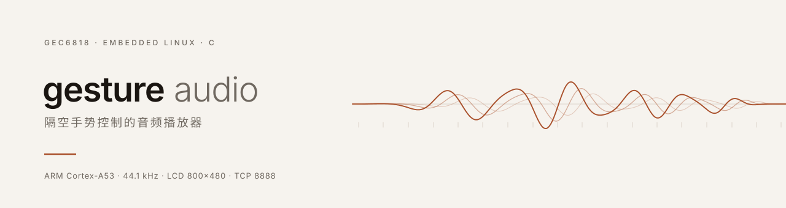

<picture>
  <source media="(prefers-color-scheme: dark)" srcset="docs/banner-dark.svg">
  
</picture>

手在传感器上方扫过，音量、速度、曲目和音效随之改变；LCD 同步显示参数与波形；一台 PC 可以经 TCP 接入，做同样的事并读取状态。一块 GEC6818 开发板，一份纯 C 代码，从采集到出声、从界面到远控，全链路自己负责。

> **在线介绍页**：<https://fe1ixfe1icis.github.io/gec6818-gesture-audio/>（GitHub Pages，源文件 `docs/index.html`，部署与维护见 `docs/PAGES.md`）

`v0.2.0` 初鸣　·　2026-11-13　·　首个进入 main 的可演示版本

## 现在能到什么程度

v0.2.0 把这条链路从「能出声」推到「能听」：音质链 19 项离线指标全过，PC 客户端与协议矩阵在主机侧闭环，板端真机出声三十秒没有一次 underrun。没做的部分也写清楚：传感器仍是模拟后端，板载网口不通；显示在 v0.2.0 是 ASCII 点阵，之后 dev 已补上中文界面与触摸（待板端实测）。

| 维度 | 状态 |
|---|---|
| 音质链 | 抗混叠重采样、软限幅、EQ 平滑与三套预设、回声阻尼、21Hz 高通、变调，离线 19 项指标全过 |
| PC 客户端 | Tkinter 界面与命令行两用，2 秒心跳、指数退避重连；协议矩阵 60 项全过 |
| 板端 | 软浮点 ABI 真机出声，30 秒 underrun 为 0，framebuffer 800×480，自检 20 项全过 |
| 手势 | 模拟后端可用，PAJ7620U2 选型已定，待到货接线 |
| 显示 | v0.2.0 为 5×7 点阵；dev 已实现 16×16 中文字模与触摸映射，待板端实测 |
| 远程链路 | 板载 eth0 的 PHY 未能识别，只能串口或 TF 卡部署，远程 TCP 暂缺 |

几个能对账的数字：1k 正弦在 2.0 倍速下的混叠抑制为 −82.5 dBc，1kHz 的 THD+N 是 0.0083%，满幅叠加 EQ +12dB 后硬削波 0 个样本，回声每遍衰减 6.3 dB，变调最大偏差 16.1 音分。全表和判据在 `RELEASE-v0.2.0.md` 第 2 节。

## 设计上的三件事

**单一写者。** 手势、网络指令、按键都只是指令的生产者：它们把请求投进唯一一条控制队列，主控线程按仲裁规则取出、写进参数存储，播放与显示只读不写。远程指令到达后三秒内手势降权，同源同类指令 150 毫秒去抖，规则只存在于 `main.c` 一处。

**接口先行。** `include/` 下的头文件、共享参数结构体，以及 `projectBrief.md` 第 6 节的通信协议，在 M1 结束时冻结。之后的演示选项都走命令行，例如 EQ 预设与变调，既不进协议，也不动结构体。

**没有板子也能跑。** ALSA、framebuffer、I2C 三处板端接口都留有主机退化路径，`make` 一条命令就能在 PC 上跑完采集、仲裁、播放、显示、网络的全链路。离线音质工具链接的是板上真跑的同一份 `effect.c` 与 `resample.c`，测出来的数字才算数。

| 模块 | 文件 | 职责 |
|---|---|---|
| 主控 | `src/main.c` | 启动参数、线程装配、并发仲裁 |
| 参数与控制 | `src/ctrl.c` | 参数存储、控制队列、状态快照，三把独立锁 |
| 采集 | `src/sensor.c` | 手势与测距；模拟后端可用，I2C 后端留给 M2 |
| 播放 | `src/player.c` | WAV 读取、状态机、音量，交给 ALSA 或空 sink |
| 重采样 | `src/resample.c` | 窗口 sinc 抗混叠，播放与离线工具共用 |
| 音效 | `src/effect.c` | 回声、21Hz 高通、三段均衡与预设 |
| 变调 | `src/pitch.c` | 时域颗粒移调，上下各 12 个半音，默认旁通 |
| 显示 | `src/display.c` | LCD 双缓冲、点阵字库，主机侧可导出 BMP |
| 网络 | `src/server.c` | 协议解析、状态周期广播 |
| 自检 | `src/selftest.c` | 20 项内置自检，不依赖声卡、LCD、传感器 |

## 目录

```
include/        公共头文件（M1 后冻结）
  config.h       全局常量：采样率、周期、参数范围、端口、仲裁窗口、版本号
  params.h       共享数据：audio_params_t、ctrl_msg_t、status_t
  ctrl.h         参数存储、控制队列、状态快照的接口
  sensor.h  player.h  effect.h  display.h  server.h
  common.h       日志、时间、枚举名
  oscompat.h     开发机自测用的薄兼容层，板端不参与编译
  app.h  selftest.h
src/            板端源码
  main.c         主控：启动参数、线程装配、并发仲裁
  ctrl.c         参数、队列、状态，三把独立锁
  log.c          分级日志
  sensor.c       手势与测距；sim 后端可用，i2c 为 M2 占位
  player.c       WAV 读取、状态机、音量，交给 ALSA 或空 sink
  resample.c     抗混叠重采样，播放与离线工具共用
  effect.c       回声、21Hz 高通、三段均衡与预设
  effect_ext.h   音效内部扩展接口，不进协议
  pitch.c        时域颗粒移调，默认旁通
  display.c      LCD 800×480 双缓冲、5×7 点阵字库
  server.c       TCP 服务器：协议解析、状态周期广播
  selftest.c     内置 20 项自检，不依赖声卡、LCD、传感器
client/         PC 客户端（M6-01）
  gesture_client.py  Tkinter 界面与命令行两用，心跳与断线重连
  README.md          客户端用法与重连说明
docs/           README 横幅，浅色与深色两版，附生成脚本
tools/          主机侧工具与脚本，逐项说明见下
```

## 工具

主机侧的脚本与小程序都放在 `tools/`，与板端代码分开，不参与交叉编译。

| 文件 | 用途 |
|---|---|
| `audio_quality.c` | 离线音质尺子，THD+N、混叠、削波、EQ、直流阻断、回声、变调，一键出报告 |
| `protocol_matrix.py` | 协议矩阵、四连接、500ms 推送与重连，主机回环一键跑 |
| `client_link_test.py` | 客户端心跳与重连回归，用假服务器代替板子 |
| `player_regress.py` | 播放状态机回归，自带 WAV 合成 |
| `gen_wav.c` | 测试素材生成器，1 秒双音接 1 秒静音循环 |
| `netctl.py` | 命令行 TCP 客户端，现场测试用 |
| `prep_demo_wav.py` | 大 WAV 裁剪、降混、重采样，串口部署前压缩体积 |
| `armbuild.sh` | Ubuntu 侧一键交叉编译与 ABI 校验（BOARD=1） |
| `pack_for_ubuntu.ps1` | Windows 侧打包成可导入 Ubuntu 的源码包 |
| `make_serial_upload.ps1` | 板端没有 rz/rb 时，生成 base64 串口上传脚本 |
| `i2c_probe.c` | 单地址 I2C 探测，M2 确认 0x73 用，避免全总线盲扫 |

## 编译

```bash
# 主机自测，没有板子也能跑逻辑层
make

# 主机侧的两个工具
make tools            # 测试素材生成器
make audio_quality    # 离线音质尺子，19 项指标

# 板端交叉编译（Ubuntu 18.04 集成机）
make BOARD=1 CROSS=arm-linux-

# 产物 ABI 与依赖校验，须在交叉工具链一侧执行
make BOARD=1 CROSS=arm-linux- READELF=readelf verify
```

从 Windows 导入 Ubuntu 的一条龙流程，两条命令分别在两台机器上执行：

```powershell
# Windows：在仓库根目录打包
powershell -NoProfile -ExecutionPolicy Bypass -File tools\pack_for_ubuntu.ps1
```

```bash
# Ubuntu：解包之后
bash tools/armbuild.sh
```

产物为 `build/gesture_audio`。板端版链接 ALSA，主机版不依赖任何硬件库。

> **工具链前缀必须与板端 loader 一致。** 本板实测是 `/lib/ld-linux.so.3`（软浮点，glibc 2.23），对应 `arm-linux-gcc`（`arm-none-linux-gnueabi`）。用 `gnueabihf` 编出的程序会要求 `/lib/ld-linux-armhf.so.3`，在板上报 `No such file or directory`。细节见 `boardGuide.md` 第 2.5 节。

## 运行

```bash
# 逻辑自检，不需要声卡、LCD、传感器
./build/gesture_audio --selftest /root/gapp/audio/test_44100.wav

# 板端正式运行
LD_LIBRARY_PATH=/root/gapp/usr/lib ALSA_CONFIG_PATH=/root/gapp/usr/share/alsa/alsa.conf \
  ./bin/gesture_audio --sensor sim --log info /root/gapp/audio/test_44100.wav

# 渲染一帧界面写进 BMP，可以拷回电脑看版式
./build/gesture_audio --dump-bmp /tmp/ui.bmp

# 音效对照：换预设、开变调
./build/gesture_audio --eq-preset vocal --pitch 7 --sensor sim audio/test_44100.wav

# PC 客户端，界面形态（Windows 无 python 别名时用 py -3.11）
py -3.11 client/gesture_client.py --host <板子IP> --port 8888

# 同一个客户端的命令行形态
py -3.11 client/gesture_client.py --cli --host <板子IP> --cmd "STATUS" --cmd "VOL 70"
```

常用选项有 `--port`、`--sensor sim|i2c`、`--no-display`、`--run <秒>`、`--eq-preset standard|vocal|demo`、`--pitch <半音>`、`--log error|warn|info|debug`、`--selftest`、`--dump-bmp`，全部选项看 `--help`。

板端部署目录是 `/root/gapp`，运行前带上 `LD_LIBRARY_PATH` 与 `ALSA_CONFIG_PATH` 两个环境变量；升级只需换二进制，回滚靠保留上一版目录，步骤见 `RELEASE-v0.2.0.md` 第 6 节。

## 通信协议

客户端与板子之间是纯文本行协议，一行一条指令，服务端口默认 8888。

| 指令 | 说明 |
|---|---|
| `PLAY` `PAUSE` `RESUME` `STOP` | 播放控制 |
| `NEXT` `PREV` | 切歌 |
| `VOL <0-100>` | 音量 |
| `SPEED <0.5-2.0>` | 播放速度 |
| `ECHO` | 后接 `on` 或 `off`、延迟毫秒、反馈百分比，例如 `ECHO on 250 40` |
| `EQ` | 后接 `low`、`mid` 或 `high` 与增益，例如 `EQ low -6` |
| `STATUS` | 状态与传感器值，板端每 500 毫秒主动上报一次 |
| `HELP` `QUIT` | 指令表、断开连接 |

## 已知限制

- 板载 eth0 的 PHY 全 0，网络不通，部署只能走串口或 TF 卡；串口约 5 KB/s，17MB 素材要传五十多分钟，演示请用 `tools/prep_demo_wav.py` 裁剪。
- 板端没有 libasound，必须随包带 `libasound.so.2.0.0` 与 `/usr/share/alsa`，否则打不开声卡；设备按 `default`、`plughw:0,0`、`hw:0,0` 的顺序回退。
- 变调是时域颗粒算法，有轻微 warble，默认关闭，只在演示时开。
- v0.2.0 的 LCD 只有 ASCII 点阵；dev 已实现 16×16 中文字模与触摸映射，尚未上板实测。
- 只有 WAV（PCM 16 位），没有 MP3 解码。

## 文档

| 文件 | 内容 |
|---|---|
| `RELEASE-v0.2.0.md` | 本版发布说明：范围、量化指标、已验证与未验证、七条已知限制、部署与回滚 |
| `projectBrief.md` | 项目简介：背景、目标、架构、技术栈、协议、里程碑、模块分工 |
| `boardGuide.md` | 开发板参考：硬件规格、启动链、设备节点、LCD、触摸、音频、GPIO、I2C、UART 编程要点、自检清单、故障排查 |
| `testGuide.md` | 板端测试：连着板子的那台机器按 T0 至 T7 分层执行，含用例表、预期输出、故障对照 |
| `boardSnapshot.md` | 本板实测快照：ABI（软浮点、glibc 2.23）、fb 与 ALSA 设备、eth0 PHY 不可用、部署通道结论 |
| `sensorSelection.md` | M2 传感器选型：PAJ7620U2 的对比、映射、接线、验收与采购，测距后置 |
| `ubuntuArmBuild.md` | 导入 Ubuntu 做 ARM 交叉编译的实施方案：打包传输、工具链与 ALSA 头、`make verify`、上板与首跑 |
| `devFlow.md` | 开发流程与纪律：分支模型、提交规范、板子占用、红线 |
| `gitGuide.md` | Git 操作指南：初始化、首次提交、分支、保护规则、日常循环、故障回滚 |
| `taskBoard.md` | 任务板与里程碑：当前阶段判定、验收门槛、任务状态、风险与排期 |
| `client/README.md` | PC 客户端用法：两种形态、界面功能、心跳与重连参数 |
| `docs/PAGES.md` | 介绍页部署与维护：GitHub Pages 设置、素材重生成、发版前验收清单 |
| `AGENT.md` | AI 协作规范：AI 不代执行任何 git 操作，操作分级与留痕要求 |
| `agentLogs/` | AI 操作留痕，一天一个文件，按 L0 至 L4 分级记录，供审计对账 |

## 协作约定

- 分支：`main` 稳定且禁止直接 push，`dev` 集成，`feat/<模块>` 开发，合入至少一人 Review。
- 提交信息写成 `<type>(<scope>): <描述>`，例如 `feat(effect): 实现回声延迟环形缓冲区`。
- 编译产物与音频素材不进仓库，规则见 `.gitignore`。
- 板子只有一块，谁占用谁报备，串口同一时间只许一人。

> 本仓库的所有 git 操作由人类执行。AI 只给出命令指南，不代执行，详见 `AGENT.md`。
